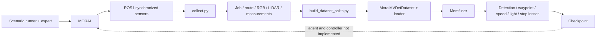

# MoraiDrive

MORAI data collection and a standalone Memfuser vision model for waypoint prediction.
`LMDrive/` remains the reference implementation. The separately added `VLDrive/`
language-model stack is not called by this MORAI vision training path.

- `scenario_runner/`: gRPC scenario setup and expert launch. It does not currently
  start `data_collection/collect.py` or manage its per-episode finalization.
- `data_collection/`: ROS1 synchronization, navigation/semantic labels and
  image/point-cloud/JSON writers. `collect.py` records one episode per invocation.
  See its [README](data_collection/README.md) for simulator execution.
- `vision_encoder/`: MORAI route/index handling, all-valid-frame loading, camera
  transforms, PointPillar/Memfuser and training. See its
  [README](vision_encoder/README.md) for the checked training path.
- A MORAI inference agent that loads the checkpoint, prepares identical online
  inputs and converts predicted waypoints to steering/throttle/brake is still missing.

The data and model computation path has been exercised on CPU with repository
samples and synthetic writer output. Simulator synchronization, sensor extrinsics,
CUDA/DDP training and closed-loop driving still require their target environments.
See [the pipeline review](vision_encoder/PIPELINE_REVIEW.md) for evidence and limits.
