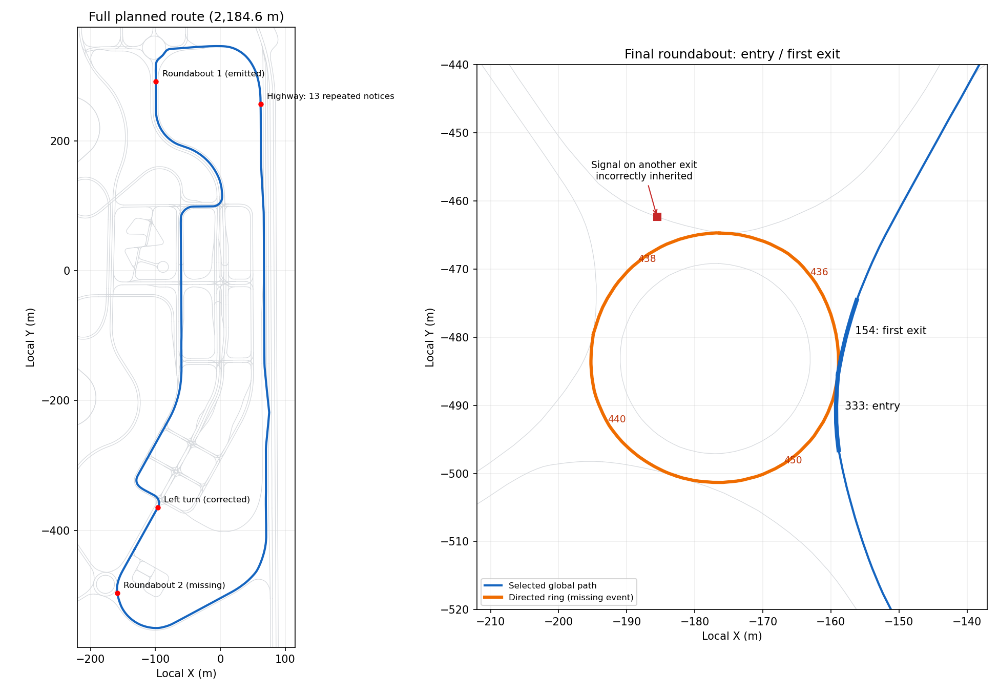

# Navigation 한 바퀴 의미 검토 — 2026-09-17

[추가 주행 검토: 첫 좌회전 뒤 우측 굽힘·고속도로 진출 누락·신호등 근거](followup.md).

현재 v2 지시에는 마지막 회전교차로 누락, 잘못된 신호등 연결, 직진 문장의 적용 범위와
실제 경로 불일치, 같은 사건의 반복 발행 문제가 남아 있다. 첫 교차로 좌회전 수정만으로
전체 지시가 올바르다고 판단할 수 없다. 이번 작업은 전체 로그의 의미 감사이며 운영 생성
규칙이나 기존 라벨을 추가 변경하지 않았다.

## 검토 자료와 범위

- 손 주행 로그: `outputs/logs/navigation_manual/20260917_223800_663108/navigation.jsonl`.
- 그 실행이 저장한 `planned_route.json`과 실제 MGeo link/node 파일, 원본 LMDrive 표현 사전.
- 감사 시점 유효 기록 8,136개, 시작 수신 대기 1개. 경로 총 길이 2,184.61m,
  실제 관측 진행 거리 약 19.9m~2,173.7m. 폐루프 연결점 통과까지 확인한 기록은 아니다.
- 아래 거리는 차량 누적 주행거리가 아니라 계획 경로 시작점으로부터의 거리이다.
- 사진/카메라 영상과 현장 표지판까지 대조한 결과는 아니다. 지도 연결·경로 좌표·실제
  출력에 근거한 확정 오류와 표현/타이밍 품질 문제를 구분했다.

## 발견 사항

| ID | 위치/지시 | 판정 | 근거와 영향 |
|---|---|---|---|
| F1 | 마지막 회전교차로, 경로 약 2,110~2,132m | 의미 누락 | `zones.roundabout` 단일 항목(상단 회전교차로)만 읽는다. 지도에 있는 마지막 순환로는 사건으로 추출되지 않는다. |
| F2 | 2,080.2m `At the next light...`, 2,123.1m `subsequent traffic signal...` | 신호 연결 오류·사건 분할 오류 | 같은 마지막 회전교차로 진입/진출 링크를 서로 다른 신호 교차로로 처리했다. 해당 경로 노드에는 신호등 연결이 없는데 다른 진출로 노드의 신호등을 전파했다. |
| F3 | 748.3m `Continue in a straight line ... until ... intersection` 등 | 직진 판단 범위 불일치 | 앞 20m만 직진 검사하고, 그 결과로 110m 이상 떨어진 다음 교차로까지 직진하라고 발행한다. 전체 구간에는 곡선이 있다. |
| F4 | 1,001.8m `Continue driving straight on this particular road.` | 템플릿 의미 충돌 | 곡선 때문에 Follow-03을 배제했지만 대체 Follow-02 원본 템플릿 variant 5에도 straight가 들어 있다. 유형 검사만으로 잘못된 표현을 막지 못한다. |
| F5 | 고속도로 1,119.4~1,700.5m, 13회 안내 | 불필요한 재발행 | 하나의 highway 사건에서 `follow_chunk_m=50`마다 다른 instance/문장을 만든다. 13개의 새로운 경로 결정이 발생한 것이 아니다. |
| F6 | 첫 회전교차로, 828.8m `Head out on the first exit.` | 문맥 생략 | 내부 rule은 Turn-05-1이고 첫 출구 판단은 지도와 맞는다. 하지만 원본 variant 3에는 roundabout 단어가 없어 운전자는 어떤 출구인지 알기 어렵다. |
| F7 | 745.6→748.3m, 1,001.8→1,008.8m, 2,069.8→2,070.2m 등 | 지시 안정성 문제 | 짧은 곡률 판정 경계에서 Follow-03 ↔ Follow-02가 바뀌고 새 표현이 발행된다. 마지막 예는 약 0.4m 차이다. |
| F8 | 첫 회전교차로의 시작/종료 범위 | 기준 정의 불일치 | 시나리오 checkpoint 구간을 교차로 진입/진출 구간으로 사용해, 교차로 연결 링크보다 넓게 잡는다. 30m 선행 안내 설정과 실제 진입 링크까지의 거리가 다르다. |

### F1/F2: 마지막 회전교차로는 지도에서 확인 가능하다

순환 링크가 방향에 맞게 하나의 폐곡선을 이룬다.

```
A2256W000436 → A2256W000438 → A2256W000440 → A2256W000450 → (처음)
```

선택된 ego 경로는 `A2256W000333`으로 순환로의 `A1256W000616` 노드에 도달하고,
`A2256W000154`로 바로 빠져나간다. 기존 출구 계수 함수에 이 확인된 순환 링크와
계획 경로를 주면 **첫 번째 출구**가 나온다. 따라서 필요한 의미는 마지막 회전교차로의
첫 출구 안내다. 큰 곡선인 `A2256W000128` 전체를 회전교차로로 취급해서는 안 된다.

현재 `mgeo.py`는 `zones.get('roundabout')`로 받은 한 구간만 특별 처리한다. 그 밖의
회전교차로를 발견하거나 목록으로 처리하는 단계가 없다. 마지막 333/154 링크에는
각각 일반 turn 사건을 만들고, 둘 모두 `traffic_light=True`를 붙인다.

그 신호등의 출처는 실제 계획 경로 밖인 `A1256W000684`의 `C1256W000121`이다.
첫 사건 시작점에서 약 43.4m, 두 번째 시작점에서 약 35.2m 떨어진 다른 진출로다.
`junction_context()`가 교차로 연결 성분 안의 **아무 노드**에 신호가 있으면 성분 전체를
신호 교차로로 만드는 것이 원인이다. 현재 데이터만으로 ego가 그 신호를 따라야 한다는
근거는 없으며, 실제 진입/진출 노드의 `traffic_light_id`는 null이다.



### F3/F4/F7: '도로를 따라가기'와 '직선 유지'의 의미가 섞인다

Follow-03-s2 발행 13회 중 8회는 **다음 교차로까지 전체 구간**이 기존 20도 직진 기준을
만족하지 않는다. 모두 같은 정도의 문장 오류라는 뜻은 아니며, `current course`처럼
모호한 표현과 `in a straight line`처럼 명확한 직선 요구를 구분해야 한다.
가장 명확한 사례는 다음과 같다.

- 748.3m에서 약 110.2m 앞까지 직선 유지 지시: 중간 곡선이 있다.
- 987.8m에서 다음 사건까지 약 1,122m를 가리키며 직진 지시: 굽은 진입부와 뒤쪽 곡선을 포함한다.
- 1,741.8m에서 약 368m 뒤까지 직진 지시: 터널 주변/종단 곡선이 포함된다.
- 1,001.8m에서는 직진 rule을 제외했는데, 일반 road-follow의 표현에서 다시 straight가 나온다.

문장 선택은 사건의 의미가 확정된 뒤 그 의미를 보존해야 한다. online에서 문장 수를
늘리는 것과 training에서 동일 의미의 표현을 다양화하는 것은 별개로 다뤄야 한다.

### F5: 고속도로 자체의 위치와 반복 발행을 구분해야 한다

지도/시나리오에서 highway로 지정한 범위는 1,118.74~1,741.72m이다. 로그의 highway
문장은 이 범위 안에서 나왔으므로 이번 기록만으로 구간 분류가 잘못됐다고 결론내리지 않는다.
확인된 문제는 같은 의미가 50m 경계마다 다시 발행되어 13개 안내처럼 보인다는 점이다.
UI에서 같은 문자열만 숨겨도 다른 표현들이 계속 나오며, underlying instance 생성 정책이
변하지 않는다. 하나의 highway 사건을 주행하는 동안 지시를 유지하는 처리가 필요하다.

### F6/F8: 첫 회전교차로도 문장과 시간 범위를 보완해야 한다

첫 번째 회전교차로의 첫 출구 계수는 현재 선택된 경로와 맞는다. 다만 `First exit.`와
`Head out on the first exit.` 같은 원본 템플릿은 회전교차로 문맥을 생략한다.

현재 사건은 checkpoint 기준 858.50~930.60m이다. 실제 선택된 진입/진출 연결 링크는
885.10~914.84m이고, 순환로에 합류하는 노드는 904.00m다. 안내는 828.8m에서 발행되어
진입 연결 링크까지 약 56.3m 남은 시점이다. 조기 안내 자체가 무조건 잘못은 아니지만,
`lookahead_m=30`이 어느 경계를 기준으로 하는지 일관되게 정의해야 한다.

## 지도/계획 경로와 일치한 주요 안내

- 첫 교차로 좌회전 후 다음 교차로 직진: v2의 Turn-06-L-S는 맞다.
- 188.4m, 286.1m의 T자 교차로 직진: 평행 차선을 묶은 세 방향 도로 연결 및 계획 경로와 맞는다.
  이 두 교차로는 신호등 근거도 있으나 현재 우선순위 때문에 T자 표현이 선택된다.
- 406.9m `Next light, straight`: 실제 진입 노드에 신호등 연결이 있고 계획 경로도 직진이다.
- 521.2m 우회전 후 좌회전: 두 계획 교차로 방향과 맞는다.
- 933.3m T자 교차로 직진: 세 방향 도로 연결 및 계획 경로와 맞는다.
- 최종 도로 복귀 후의 다음 교차로 안내는 `closed=true`인 반복 경로 정책이다.
  '한 바퀴 종료/목적지 도착' 기능은 현재 따로 없다. 이것을 회전교차로 누락과 혼동하지 않는다.

## 필요한 수정과 검증 기준

1. 사건 추출: 다중 회전교차로와 선택된 진입/진출 링크를 인식하고, 같은 교차로 안의
   여러 링크를 하나의 사건으로 묶는다. 시나리오 NPC 활성 구간을 교차로 전체 목록으로 사용하지 않는다.
2. 신호 연결: ego 접근 차로에 실제 연결된 신호만 사용한다. 다른 진출로 신호가 전파되지 않아야 한다.
3. 의미/표현: 직진 안내의 전체 유효 구간을 검사하고 곡선에서는 도로 추종 표현을 쓴다.
   모든 허용 template variant에 대해 의미를 검사하며, 회전교차로 문맥을 명시한다.
4. 발행 수명: 같은 도로/고속도로 사건에서는 문장을 유지한다. 곡률 경계의 짧은 변화로
   사건을 재발행하지 않도록 하고, 학습용 표현 증강은 별도로 유지한다.
5. 이 손 주행 기록으로 기대 사건표를 고정해 검증한다. 두 회전교차로가 각각 한 번의
   올바른 안내로 나타나고, 마지막의 잘못된 신호등 지시 두 개가 없어져야 한다.
   의미가 바뀌면 새 버전 라벨·캐시를 생성한다.

이전의 '리플레이 불일치 0'은 두 실행 경로가 같은 규칙을 재현했다는 검증이다.
그 규칙이 지도/실제 장면의 의미와 맞는지까지 입증한 결과는 아니었다.
현재 v2에 위 문제가 남아 있음을 학습 데이터 검토에 반영해야 한다.

## 증거 파일

- [발행 지시 전체와 경로 사건](full_lap_before.json)
- [교차로 연결·신호 출처·직진 구간 검사](full_lap_details.json)
- [입력/구현 SHA256](provenance.json)

아래 표는 감사 시점 전체 지시 전환을 순서대로 정리한 것이다. 사용자 메시지 이후
정지 상태에서 추가로 발행된 마지막 문장도 로그에 있으면 포함한다.

## 전체 지시 전환 대조표

| 번호 | 발행 위치(m) | rule | 원문 | 검토 |
|---|---:|---|---|---|
| 1 | 19.9 | Follow-03-s2 | Keep going straight until you reach the next junction, you're on the right track! | 지도/계획 경로상 의미 일치 |
| 2 | 42.9 | Turn-06-L-S | After you've successfully made a left turn at the current intersection, your next step should be to continue in a straight direction at the upcoming intersection. | 지도/계획 경로상 의미 일치 |
| 3 | 188.4 | Turn-04-S | At the upcoming T-intersection, proceed straight. | 지도/계획 경로상 의미 일치 |
| 4 | 239.5 | Follow-03-s2 | Keep on rolling straight till you get to the next junction. | F3: 전체 유효 구간은 직선이 아님 |
| 5 | 286.1 | Turn-04-S | Next T, keep straight. | 지도/계획 경로상 의미 일치 |
| 6 | 349.1 | Follow-03-s2 | Maintain your current course until the upcoming intersection. | 지도/계획 경로상 의미 일치 |
| 7 | 406.9 | Turn-03-S | Next light, straight. | 지도/계획 경로상 의미 일치 |
| 8 | 465.3 | Follow-03-s2 | Keep going straight until you reach the next junction, you're on the right track! | 지도/계획 경로상 의미 일치 |
| 9 | 521.2 | Turn-06-R-L | After making a right turn at the current intersection, make a left turn at the next intersection. | 지도/계획 경로상 의미 일치 |
| 10 | 637.2 | Follow-03-s2 | Preserve your current trajectory until the forthcoming intersection. | F3: 전체 유효 구간은 직선이 아님 |
| 11 | 745.6 | Follow-02-s1 | Keep cruising down this road. | 도로 추종 의미는 타당 / F7: 앞뒤 짧은 전환 확인 |
| 12 | 748.3 | Follow-03-s2 | Continue in a straight line along your current path until you reach the upcoming intersection. | F3: 전체 유효 구간은 직선이 아님 |
| 13 | 828.8 | Turn-05-1 | Head out on the first exit. | 출구 번호 일치 / F6·F8: 문맥·경계 보완 |
| 14 | 933.3 | Turn-04-S | Next T-junction, go straight. | 지도/계획 경로상 의미 일치 |
| 15 | 987.8 | Follow-03-s2 | Keep going straight until you reach the next junction, you're on the right track! | F3: 전체 유효 구간은 직선이 아님 |
| 16 | 1001.8 | Follow-02-s1 | Continue driving straight on this particular road. | F4: 곡선용 대체 유형에서 straight 선택 |
| 17 | 1008.8 | Follow-03-s2 | Keep going straight until you reach the next junction, you're on the right track! | F3: 전체 유효 구간은 직선이 아님 |
| 18 | 1119.4 | Follow-02-s2 | Do not deviate from the highway. | 구간 일치 / F5: 같은 highway에서 재발행 |
| 19 | 1150.5 | Follow-02-s2 | Keep cruising down the highway. | 구간 일치 / F5: 같은 highway에서 재발행 |
| 20 | 1200.2 | Follow-02-s2 | Do not deviate from the highway. | 구간 일치 / F5: 같은 highway에서 재발행 |
| 21 | 1250.3 | Follow-02-s2 | Do not deviate from the highway. | 구간 일치 / F5: 같은 highway에서 재발행 |
| 22 | 1300.7 | Follow-02-s2 | Just keep on rolling down the highway. | 구간 일치 / F5: 같은 highway에서 재발행 |
| 23 | 1350.7 | Follow-02-s2 | Proceed along the highway. | 구간 일치 / F5: 같은 highway에서 재발행 |
| 24 | 1400.1 | Follow-02-s2 | Continue driving straight on the designated highway. | 구간 일치 / F5: 같은 highway에서 재발행 |
| 25 | 1450.4 | Follow-02-s2 | Continue on the highway. | 구간 일치 / F5: 같은 highway에서 재발행 |
| 26 | 1500.4 | Follow-02-s2 | Just keep on rolling down the highway. | 구간 일치 / F5: 같은 highway에서 재발행 |
| 27 | 1550.0 | Follow-02-s2 | Continue driving straight on the designated highway. | 구간 일치 / F5: 같은 highway에서 재발행 |
| 28 | 1601.1 | Follow-02-s2 | Continue on the highway. | 구간 일치 / F5: 같은 highway에서 재발행 |
| 29 | 1650.2 | Follow-02-s2 | Proceed along the highway. | 구간 일치 / F5: 같은 highway에서 재발행 |
| 30 | 1700.5 | Follow-02-s2 | Just keep on rolling down the highway. | 구간 일치 / F5: 같은 highway에서 재발행 |
| 31 | 1741.8 | Follow-03-s2 | Keep going straight until you reach the next junction, you're on the right track! | F3: 전체 유효 구간은 직선이 아님 |
| 32 | 2007.7 | Follow-02-s1 | Just keep on rolling down this road. | 도로 추종 의미는 타당 / F7: 앞뒤 짧은 전환 확인 |
| 33 | 2013.5 | Follow-03-s2 | Keep on rolling straight till you get to the next junction. | F3: 전체 유효 구간은 직선이 아님 |
| 34 | 2069.8 | Follow-02-s1 | Continue on this road. | 도로 추종 의미는 타당 / F7: 앞뒤 짧은 전환 확인 |
| 35 | 2070.2 | Follow-03-s2 | Stay straight until the next intersection. | F3: 전체 유효 구간은 직선이 아님 |
| 36 | 2080.2 | Turn-03-S | At the next light, just keep heading straight. | F1/F2: 회전교차로를 신호 교차로로 오인 |
| 37 | 2123.1 | Turn-03-S | Continue straight at the subsequent traffic signal, without deviation. | F1/F2: 회전교차로를 신호 교차로로 오인 |
| 38 | 2134.6 | Follow-03-s2 | Preserve your current trajectory until the forthcoming intersection. | 지도/계획 경로상 의미 일치 |
| 39 | 2173.7 | Follow-03-s2 | Stay straight until the next intersection. | 지도/계획 경로상 의미 일치 |
