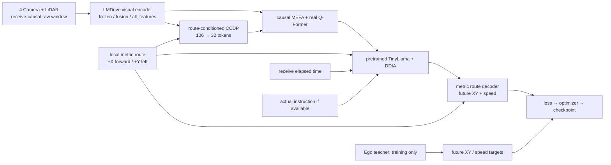

# MORAI 목표 구조 전체의 소규모 학습·검증

현재 entry는 `scripts/train_goal_stack.py`다. 기존 Stage6F/G의 부분 실험을 보존하고,
동일 데이터 위에 raw visual encoder와 실제 pretrained LM까지 연결한 Stage6H 경로를 추가했다.
현재 구현을 최종 주행 모델로 확정하는 문서는 아니다. 과거 실행 근거·수치와 비교 실험 도구는
로컬 `reports/`와 원래 실험 폴더에 보존하며 이번 실행용 패키지에는 포함하지 않는다.



## 입력·teacher·시간 계약

모델에 전달할 수 있는 것은 `sensors` 또는 frozen 비교용 `visual_feature`, `route`,
`elapsed_s`, `instruction`뿐이다. `/Ego_topic`, future trajectory/speed, GPS/IMU의 ROS object,
source timestamp, 현재 teacher speed/heading은 model forward에 들어가지 않는다.
GPS/IMU는 향후 runtime localization용이며 현재 offline forward에 직접 전달하지 않는다.

- `GoalSequenceDataset`은 기존 전체 run 검사와 run 단위 split을 재사용하고, 저장된 future speed를
  raw teacher velocity의 보간 결과와 대조한다. teacher source clock은 teacher 내부의 GT 보간에만 사용한다.
- Camera와 LiDAR의 대응, history 순서, gap 판단은 receive monotonic time을 기준으로 한다.
  model time은 window의 첫 receive time부터의 경과 초다. 미래의 마지막 시각으로 정규화하지 않는다.
- `route`는 `[B,T,41,2]`, metre 단위, +X forward/+Y left다. teacher pose로 만든 학습용 local route와
  GPS/IMU localization으로 만드는 runtime local route의 일치는 별도 live 검증이 필요하다.
- visual encoder의 velocity 입력은 명시적으로 0이다. cached feature와 raw input의 축 보정·checkpoint hash를 확인한다.
- 현재 실제 데이터에는 instruction annotation이 없다. 빈 문자열에서 BOS/EOS/상용구 prompt를 만들지 않는다.
  DDIA의 의미 이해 효과를 이 데이터에서 검증했다고 해석하지 않는다.

## 실제 모델과 학습 정책

Visual encoder는 실제 LMDrive r50 checkpoint를 strict load한다. 네 카메라의 front/left/right/rear와
front crop, 두 LiDAR sweep의 기존 전처리를 재사용한다. 출력은 프레임마다 `[106,256]`이다.
`frozen`은 전체 고정, `fusion`은 visual transformer와 view/query embedding 학습,
`all_features`는 RGB backbone·projection·LiDAR backbone까지 학습한다. 작은 batch에서
BatchNorm running statistics와 dropout은 eval 상태로 유지하며, 선택된 weight의 gradient는 활성화한다.
메모리 절약용 checkpointing은 모든 시점의 encoder 학습 graph를 보존한다.

Q-Former는 팀 `VLDrive/LAVIS/lavis/models/blip2_models/Qformer.py`를 사용한다.
현재 작은 실험 설정은 width 256, 2 layers, 8 heads, connector output 512다.
논문 저자 코드와 동일한 hyperparameter라고 주장하지 않는다. MEFA는 이전 frame 평균과
현재 feature의 MLP 결합이며, 미래 frame이나 다른 run을 보지 않는다.

LM은 실제 pretrained TinyLlama 1.1B decoder다. 새 임의 LM이나 Lite mock으로 대체하지 않았다.
현재 `last_layer` 정책은 마지막 decoder layer와 final norm을 학습하고 나머지를 고정한다.
`frozen`/`full` 정책도 설정 가능하며, 전체 LM 학습은 별도 GPU 용량 검증이 필요하다.
LM 마지막 층을 고정하더라도 connector로 돌아오는 gradient를 끊지 않는다.
학습 parameter와 Adam state는 FP32, 기본 forward는 BF16 autocast다.

프레임별 `[metric route token, retained visual tokens]`를 시간순으로 LM에 넣는다.
route token을 semantic instruction으로 취급하지 않는다. 실제 instruction이 있으면 앞에 두되,
해당 annotation의 receive-monotonic availability가 window 시작 이전임을 확인한다.
padding은 modality mask와 유효 token 누적 position으로 처리한다. readout은 각 프레임의
유효 visual token을 pooling하며, padding이 섞였을 때 잘못되는 `count-1` 인덱스를 사용하지 않는다.

decoder는 예측 speed를 0.5초 간격으로 적분한 route 진행거리와 학습한 XY residual을 결합한다.
진행거리 0의 기준은 ego 원점이다. 원점에서 route 첫 점까지의 직선 연결 길이를 먼저 소비하고,
이후 원래 route의 metric geometry를 따라간다. route를 평행 이동해 원점에 맞추지는 않는다.
route 끝을 넘으면 마지막 tangent로 연장해 speed gradient가 끊기지 않게 한다.
출력은 `[B,T,5,2]` XY와 `[B,T,5]` m/s이며 마지막 frame의 GT에 loss를 적용한다.
이 표현이 collision-free 또는 차량 운동학을 보장하지는 않는다.

## 연결 중 발견하고 고친 문제

1. instruction이 없는 DDIA의 첫 visual query는 허용 key가 없다. 기존 attention의 수치 안정화용
   자기참조 fallback이 실제 출력에 남았으므로, `EmptySafeDDIAAttention`이 그 행의 attention
   output/probability를 0으로 만든다. residual connection은 유지한다.
2. 기존 dataset에는 future speed가 저장돼 있었지만 기존 학습 head/loss에는 연결되지 않았다.
   새 loader가 teacher와 speed를 대조하고 speed head/loss/평가에 연결한다.
3. 새 전체 학습의 초기 Bernoulli CCDP 실험에서는 retention penalty가 충분히 작용하지 않아
   학습 query가 106개까지 증가했으나 평가 query는 top-32였다. 이 train/eval 불일치는 기록에 남겼다.
   기본 `fixed_budget` 정책은 기존 route-conditioned scoring과 MEFA를 재사용하면서,
   train의 Gumbel ranking과 eval의 deterministic ranking 모두 정확히 32개를 선택한다.
   학습 ranking의 straight-through surrogate는 K-scaled softmax다. 이는 공개되지 않은 저자 코드의
   복원이라고 주장하는 부분이 아니라, 본 실험의 명시적인 fixed-budget 선택 정책이다.
   원래 Bernoulli 정책은 `selection_policy=reference_bernoulli`로 남아 있다.
4. Memfuser constructor는 complete LMDrive checkpoint를 읽기 전에 ImageNet weight를 다시 받으려 했다.
   새 경로는 이 중복 초기 다운로드만 생략하고 complete checkpoint strict load를 유지한다.
5. 실제 LiDAR의 native GPU `scatter_mean`을 100회 반복했을 때 최대 약 3.8e-6m 차이가 발생했다.
   PointPillar의 평균·최대값 계산을 정렬 후 `segment_csr`로 연결해 같은 수학적 연산의 반복성을 확보했다.
   기존 atomic reduction의 비결정성과 CSR의 결정성은 [공식 문서](https://pytorch-scatter.readthedocs.io/en/latest/functions/segment_csr.html)에도 설명돼 있다.
   동일 raw LiDAR에 대한 수정 후 반복 차이는 0이었다. 원래 team timm 파일은 수정하지 않았다.
6. 스칼라 integer buffer 해시와 checkpoint 무결성 검사를 보강했다. JSON은 임시 파일을 완성한 뒤 교체하고,
   학습 중 checkpoint를 남기며 마지막 optimizer 상태는 validation 전에 저장한다.
7. 초기 metric decoder는 global path에 투영한 route 첫 점을 ego 위치로 취급했다. 실제 validation에서
   두 점의 거리는 최대 31.77m여서, speed와 residual이 0이어도 먼 경로 점을 출력하는 문제가 있었다.
   ego 원점에서 시작하는 연결 구간을 명시해 수정했다. 이 직선 연결과 learned residual 자체가
   차량 운동학을 보장하는 것은 아니며, route 이탈·localization 오차의 원인은 별도 구분해야 한다.

## 실행

[README](../README.md)에 따라 별도 환경과 자산·데이터를 준비한 뒤 실행한다. 기존 로컬 private 환경은 Git에 포함되지 않는다.

```bash
cd VLDrive/experiments/morai_stage6
export PYTHONDONTWRITEBYTECODE=1

# 전체 데이터 artifact 검사 + 실제 센서/LM gradient + causal preflight, optimizer update 없음
python scripts/train_goal_stack.py \
  --config configs/goal_stack_small.json --mode preflight \
  --output reports/my_goal_preflight

# 전체 목표 graph의 작은 학습: train 8 windows / 다른 run의 val 16 windows
python scripts/train_goal_stack.py \
  --config configs/goal_stack_small.json --output reports/my_goal_training

# 저장 모델의 새 프로세스 예측 재현 + optimizer/RNG 다음 step 재현
python scripts/verify_goal_checkpoint.py \
  --experiment reports/my_goal_training --output reports/my_goal_restore

# 중단 후 재개: updates는 추가 횟수가 아니라 최종 누적 횟수
python scripts/train_goal_stack.py \
  --config configs/goal_stack_small.json --checkpoint reports/my_goal_training/checkpoint_000080.pt \
  --updates 240 --output reports/my_goal_resumed

# 현재 작은 두 run 전체 사용: T=4에서 train 498 / val 1018 windows, 1 training epoch
python scripts/train_goal_stack.py \
  --config configs/goal_stack_small.json --train-windows 0 --val-windows 0 \
  --updates 498 --output reports/my_goal_full_runs

# 같은 전체 모델에서 visual encoder 정책을 변경해 학습
python scripts/train_goal_stack.py \
  --config configs/goal_stack_all_features.json --output reports/my_goal_all_features
```

모든 output은 존재하지 않는 새 폴더를 지정한다. 원본 데이터와 기존 checkpoint를 덮어쓰지 않는다.
기본 배치는 1이고, seed와 window 순서, optimizer/RNG, source/data/base-weight hash를 저장한다. data hash에는 manifest뿐 아니라 실제 JPEG/NPY/route/label 내용도 포함한다.
encoder 학습을 켜고 cached 입력을 선택하면 실패한다. code/data/학습 정책이 바뀐 checkpoint는
기존 학습의 정확한 resume으로 취급하지 않는다.

새 컴퓨터는 `environment_goal_stack.yml`로 별도 환경을 만들고, 실제 dataset과 pretrained vision
checkpoint를 준비한 뒤 `scripts/prepare_goal_assets.py --vision-checkpoint ... --download-language`를
실행한다. 자산과 runtime 환경은 Git에 포함되지 않는다. 일반 pip timm 대신 팀 custom timm을 사용한다.

Instruction JSONL을 나중에 추가한다면 실제 annotation만 다음 필드로 기록한다:
`run_id`, `text`, `source`, `available_receive_monotonic_ns`. 설정의 `instructions`가 이 파일을 가리킨다.
현재 데이터에 synthetic instruction을 붙여 semantic task가 학습됐다고 보고하지 않는다.

## 해석 범위

통과 기준은 실제 raw 센서부터 loss까지의 gradient, 미래→과거 영향 0, 모든 센서·route·history 의존성,
teacher input 차단, 유한한 실제 optimizer update, frozen parameter 불변, checkpoint/예측/재개 재현이다.
작은 training subset의 loss 감소와 독립 validation 성능은 따로 보고한다.

아직 확정할 수 없는 것은 대규모 일반화, DDIA의 언어 이해 이득, 최종 freeze 정책과 history 길이,
closed-loop 주행 및 GPS/IMU localization과 controller 연결이다. 현재 train/val 두 주행의 속도·경로
분포도 다르므로 한쪽 결과만으로 architecture를 확정하지 않는다. 데이터를 대규모로 늘리기 전에
작은 주행을 몇 개 더 분리해 같은 공통 trainer에서 비교하는 것이 다음 실험이다.

관련 외부 원본: [TinyLlama checkpoint](https://huggingface.co/TinyLlama/TinyLlama-1.1B-intermediate-step-1431k-3T),
[Transformers 4.31 LLaMA](https://huggingface.co/docs/transformers/v4.31.0/en/model_doc/llama),
[VLDrive 논문](https://openaccess.thecvf.com/content/ICCV2025/papers/Zhang_VLDrive_Vision-Augmented_Lightweight_MLLMs_for_Efficient_Language-grounded_Autonomous_Driving_ICCV_2025_paper.pdf).

단위 테스트와 탐색 실험 실행기는 업로드 대상에서 제외했다. 수집 품질 검사와 trainer의
preflight·checkpoint 검증은 유지한다. 최소 파일 구성과 기존 checkpoint의 source 목록 차이는
[파일 범위](GIT_SCOPE.md)를 참고한다.
